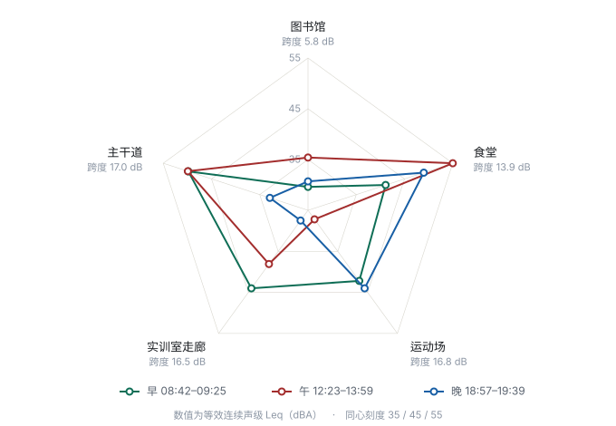
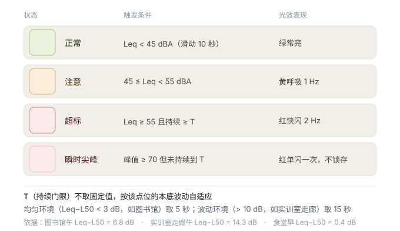

# 课题 06 · 昼夜声学噪声地图 —— 读数汇总与分析

> 数据采集：2026-10-16（周五）、2026-10-17（周六）
> 测量设备：iPhone 17（基础款）＋ NoiseLedger 2.0（A 计权 dBA）
> 点位：5 个 × 早 / 午 / 晚 3 时段 = **15 组**

---

## 一、数据概况

| 项目 | 情况 |
|---|---|
| 组数 | **15 / 15**，无缺失 |
| 每组材料 | NoiseLedger 原始导出（CSV）＋ 本人现场同框照 |
| 采样间隔 | 约 1 秒 1 个采样点，每组 500 – 1230 个点 |
| 采样时长 | **1.3 – 3.6 分钟**（规范要求 3–5 分钟，**仅 2 组达标**，见"局限"第 2 条）|
| 时段定义 | 早 08:42–09:25｜午 12:23–13:59｜晚 18:57–19:39 |

**点位编号**

| 编号 | 点位 | 类型 |
|---|---|---|
| P01 | 图书馆 | 室内安静区 |
| P02 | 食堂 | 室内人流区 |
| P03 | 主干道 | 室外道路 |
| P04 | 运动场 | 室外开阔 |
| P05 | 实训室走廊 | 室内通行廊道 |

---

## 二、完整读数（15 组）

单位为 dBA。`Leq` = 等效连续声级（整段平均）；`L10/L50/L90` = 分别有 10%/50%/90% 的时间超过该值；`Leq − L50` 反映"平均值被突发事件抬高了多少"。

| 编号 | 时段 | 日期 | 时间 | 时长 | **Leq** | L10 | L50 | L90 | Max | Min | Leq−L50 |
|---|---|---|---|---|---|---|---|---|---|---|---|
| P01 图书馆 | 早 | 10-16 | 08:57 | 2.3 分 | **29.6** | 32.0 | 27.1 | 24.2 | 41.6 | 21.1 | 2.5 |
| P01 图书馆 | 午 | 10-17 | 13:47 | 3.0 分 | **35.4** | 33.5 | 28.6 | 25.9 | 51.4 | 23.1 | 6.8 |
| P01 图书馆 | 晚 | 10-16 | 19:29 | 2.6 分 | **30.7** | 32.6 | 26.9 | 22.9 | 41.4 | 19.5 | 3.8 |
| P02 食堂 | 早 | 10-16 | 08:42 | 2.0 分 | **41.1** | 41.4 | 40.7 | 40.3 | 48.5 | 39.9 | 0.4 |
| P02 食堂 | 午 | 10-16 | 12:23 | 3.6 分 | **55.0** | 56.8 | 49.1 | 43.4 | 65.5 | 39.4 | 5.9 |
| P02 食堂 | 晚 | 10-16 | 18:57 | 2.6 分 | **49.0** | 47.2 | 42.2 | 38.9 | 62.1 | 36.0 | 6.8 |
| P03 主干道 | 早 | 10-16 | 08:50 | 2.5 分 | **49.8** | 50.8 | 43.5 | 33.2 | 66.2 | 30.1 | 6.3 |
| P03 主干道 | 午 | 10-17 | 13:59 | 3.0 分 | **49.9** | 53.7 | 48.5 | 39.5 | 59.6 | 23.5 | 1.4 |
| P03 主干道 | 晚 | 10-16 | 19:04 | 2.0 分 | **32.9** | 35.0 | 31.8 | 29.7 | 43.2 | 28.9 | 1.1 |
| P04 运动场 | 早 | 10-16 | 09:25 | 2.8 分 | **42.2** | 41.6 | 36.4 | 34.5 | 61.2 | 27.1 | 5.8 |
| P04 运动场 | 午 | 10-16 | 12:48 | 2.6 分 | **27.2** | 28.6 | 24.8 | 23.0 | 41.2 | 21.7 | 2.4 |
| P04 运动场 | 晚 | 10-16 | 19:39 | 2.7 分 | **44.0** | 40.5 | 34.9 | 31.6 | 57.6 | 28.4 | 9.1 |
| P05 实训室走廊 | 早 | 10-16 | 09:03 | 2.2 分 | **44.0** | 46.5 | 43.0 | 37.4 | 56.2 | 33.0 | 1.0 |
| P05 实训室走廊 | 午 | 10-17 | 13:36 | 1.3 分 | **38.1** | 31.3 | 23.8 | 20.9 | 55.3 | 20.2 | 14.3 |
| P05 实训室走廊 | 晚 | 10-16 | 19:20 | 2.0 分 | **27.5** | 27.9 | 24.7 | 24.2 | 39.6 | 23.7 | 2.8 |

---

## 三、核心读数矩阵（Leq）

| 点位 | 早 | 午 | 晚 | 时段极差 |
|---|---|---|---|---|
| P01 图书馆 | 29.6 | **35.4** | 30.7 | **5.8 dB** |
| P02 食堂 | 41.1 | **55.0** | 49.0 | **13.9 dB** |
| P03 主干道 | 49.8 | **49.9** | 32.9 | **17.0 dB** |
| P04 运动场 | 42.2 | 27.2 | **44.0** | **16.8 dB** |
| P05 实训室走廊 | **44.0** | 38.1 | 27.5 | **16.5 dB** |

（加粗 = 该点位最吵的时段）

**全局范围：27.2（运动场·午）～ 55.0（食堂·午），相差 27.8 dB，声能相差约 600 倍。**

---

## 四、四条主要发现

### 发现 1：三个时段的"谁最吵"排序完全不同

| 时段 | 从静到吵 | 极差 |
|---|---|---|
| **早** | 图书馆 29.6 < 食堂 41.1 < 运动场 42.2 < 走廊 44.0 < **主干道 49.8** | 20.2 dB |
| **午** | 运动场 27.2 < 图书馆 35.4 < 走廊 38.1 < 主干道 49.9 < **食堂 55.0** | 27.8 dB |
| **晚** | 走廊 27.5 < 图书馆 30.7 < 主干道 32.9 < 运动场 44.0 < **食堂 49.0** | 21.5 dB |

**同一个校园，"最吵的地方"早上是主干道，中午和晚上都是食堂。**

食堂早上只排第 2 静（41.1），到了中午直接跳到最吵（55.0）—— 一个点位在两个时段之间横跨了整个排序。

这条给了我一个直接结论：**用"单次测量"给地点排噪声等级，是不可靠的。** 必须写清时段，否则这个排名没有意义。

### 发现 2：时段和地点，是同一量级的两个变量

| 变量 | 变化幅度 |
|---|---|
| **换地点**（同一时段内，5 个点位之间） | 早 20.2 dB ／ 午 27.8 dB ／ 晚 21.5 dB |
| **换时段**（同一点位内，早午晚之间） | 5.8 / 13.9 / 17.0 / 16.8 / 16.5 dB，平均约 14 dB |

**同一个人在同一个位置，只是换个时间来，声级就能差 17 dB（声能约 50 倍）。**

这跟"换个地方"带来的差异（20～28 dB）是同一个数量级。所以我原本"按地点分噪声等级"的思路是不完整的 —— **校园声环境是个「地点 × 时段」的二维表，不是一条一维的排名。**

### 发现 3：Leq 相同，但环境可以完全不一样

**主干道 早 49.8 ／ 午 49.9 —— Leq 只差 0.1 dB，几乎一模一样。**

但拆开看内部结构：

| 主干道 | Leq | **L50** | L10 | Max | Leq−L50 |
|---|---|---|---|---|---|
| 早 08:50 | 49.8 | **43.5** | 50.8 | **66.2** | 6.3 |
| 午 13:59 | 49.9 | **48.5** | 53.7 | 59.6 | **1.4** |

**L50 差了 5 dB，Max 差了 6.6 dB，走向完全相反。**

对应到现场就是两种完全不同的环境：

- **早上**：底噪较低（L50 43.5），但有**间歇性高噪声**（车经过，Max 66.2）→ 平均值被尖峰拉上去
- **中午**：底噪抬得很高（L50 48.5），但**波动小**（差仅 1.4 dB）→ 因为校园从开学起一直在**持续装修**

**如果我只看 Leq，这两组数据会被当成"同一个环境测了两次"。** 而实际上一个是"偶尔吵一下"，一个是"一直吵"。**对治理来说，这是两个完全不同的问题。**

这条是我这次最想写进报告的发现：**Leq 一个数字不足以描述声环境，必须配 L50 / L90 一起看。**

### 发现 4：两个"安静"的地方，安静的性质不同

同样是下午 13:36–13:47 测的、Leq 都在 35–38 的两个室内点位：

| | Leq | L50 | **Leq−L50** | Max |
|---|---|---|---|---|
| 图书馆 午 | 35.4 | **28.6** | **6.8** | 51.4 |
| 实训室走廊 午 | **38.1** | **23.8** | **14.3** | 55.3 |

**走廊平时比图书馆还静（L50 低 4.8 dB），但它的 Leq 反而更高。**

因为走廊是「**安静 + 偶尔被打断**」（有人走过、开门），图书馆是「**均匀的安静**」。

> 这条对我后面要做的「声学超标自动提醒光效」有直接用处：
> **图书馆那种均匀环境，设个门限就够；走廊那种必须加"持续时间"条件** ——
> 否则有人走过去就触发一次，误报会把使用者烦死。**这个设计逻辑现在有数据支撑了。**

---

## 五、一个方法论上的反思：耳朵靠不住

**运动场**是我印象最深的一组：

| 运动场 | Leq | Max | Min |
|---|---|---|---|
| 早 09:25（鸟多、人少） | **42.2** | 61.2 | 27.1 |
| 午 12:48（太热、没人） | **27.2** | 41.2 | 21.7 |

我在中午测完，当时的判断是「**感觉跟早上差不多**」。

**实际差 15 dB —— 声能只有早上的约 1/32。**

原因后来想明白了：早上那片"安静"里有大量鸟鸣，中午太热鸟不叫了，人也走了，场地的本底真正露了出来。**耳朵对声级变化的敏感度，远低于我自己的想象。**

**这就是必须靠仪器的理由。** 如果这次只凭感受记录，这一组数据会直接写错。

---

## 六、局限（我自己先写清楚）

1. **日期不统一**：15 组里 12 组是 10-16（周五），3 组是 10-17（周六）。**"午"这一列内部也不统一 —— 食堂、运动场是周五测的，图书馆、主干道、走廊是周六测的。** 周末人少，所以"午间排序"里混了「工作日活动水平」的差异，不能全部当"时段效应"读。
2. **采样时长不足**：规范要求每点位 3–5 分钟，**15 组中仅 2 组达到 3 分钟**，最短仅 1.3 分钟。短采样对"偶发事件型"环境的代表性有限 —— 尤其走廊那组，1.3 分钟就可能漏掉或放大某次人声经过。
3. **非标准声级计**：iPhone ＋ App 的麦克风频响与校准都不如专业声级计，**绝对值只能作横向对比，不宜与国标限值直接比对**。
4. **设备与操作未完全标准化**：全程手持拍摄，握持角度、手机壳、风口朝向都会影响读数。
5. **时段点单一**：每个"早/午/晚"各只测 1 次，没有重复测量，无法评估单组数据自身的波动（课题 03 的经验告诉我，同一条件连测 3 次差异会很大）。
6. **点位位置未精确记录**：只写了"图书馆""走廊"这种范围描述，没有具体坐标或楼层，换人复测难以完全复现。
7. **天气/风未记录**：室外点位（主干道、运动场）的读数会受风影响，本次没有同步记录风速。

---

## 七、可视化：三时段雷达图

**读法**：五条轴是 5 个点位（按早间 Leq 从静到吵排列），三条折线分别是早、午、晚。越靠外越吵。

**这张图要说的就一件事：三条线的形状彼此对不上。**

- **早间线**（绿）：朝「主干道」和「实训室走廊」方向鼓出去，在「图书馆」方向塌陷 —— 早高峰的车流 + 上课人流
- **午间线**（红）：形状整个变了，「食堂」方向冲到最外圈（55.0），「运动场」方向反而塌到接近圆心（27.2）
- **晚间线**（蓝）：又是第三种形状，「食堂」仍在外围，但「主干道」和「走廊」都收回来了

**如果校园声环境是"固定按地点排列"的，这三条线应该形状相同、只是整体缩放。** 而实际上它们完全不同 —— 这就是「地点 × 时段」二维结构最直观的证据。

各轴下方的「跨度」是该点位早午晚的极差：图书馆最小（5.8 dB），主干道最大（17.0 dB）。**说明有的地方"什么时候去都一样"，有的地方"去错时间差 17 dB"。**

---

## 八、声学超标自动提醒光效逻辑设计

**设计出发点**：如果只做"超过某个 dB 数就亮红灯"，在实训室走廊那种地方会疯狂误报 —— 有人走过一次就闪一次，用不了几天使用者就会把提示当噪声本身。

而数据显示，走廊中午 **Leq 38.1 但 L50 只有 23.8**，差 **14.3 dB**：它平时极度安静，那个 38.1 是几次路过硬拉上去的。**这种环境必须加"持续时间"条件。**

反过来，食堂早上 **Leq−L50 只有 0.4 dB**，是一个持续平稳的声场（吹风机、空调）。**这种环境不用等，超了就该立刻亮。**

**所以同一个 55 dB，在这两个地方的正确反应是相反的。** 把它们区分开的工具，就是 L50。

**核心设计**（详见上图）：

| 状态 | 触发条件 | 光效 |
|---|---|---|
| 正常 | Leq < 45 dBA（滑动 10 秒窗口） | 绿常亮 |
| 注意 | 45 ≤ Leq < 55 dBA | 黄呼吸 1 Hz |
| 超标 | Leq ≥ 55 且**持续 ≥ T** | 红快闪 2 Hz |
| 瞬时尖峰 | 峰值 ≥ 70 但**未持续到 T** | 红单闪一次，不锁存 |

**最有原创性的一条：T 不取固定值，按各点位自己的本底波动自适应。**

- 均匀环境（Leq−L50 < 3 dB，如图书馆）→ **T = 5 秒**
- 波动环境（Leq−L50 > 10 dB，如走廊）→ **T = 15 秒**

**这个阈值不是从教科书抄的，是本次测量数据推出来的。** 换句话说：**先用测量认识这个空间的声学性格，再决定用什么规则去提醒它。**

---

## 九、下一步

1. **可以补强的地方**（若时间允许）：给「午」这一列补一个工作日的重复测量，让三个时段同源；把采样时长统一到 3 分钟以上。
2. 把本课题的结论并入第一阶段总报告，与课题 03（无线信号盲区）对照 —— 两者其实指向同一个方法论问题：**单一指标会骗人**。

---

*本文档由本人汇总测量数据后整理。全部原始数据与导出文件见同目录，同框照见 `课题06-采集-20261016/`，图表见 `课题06-雷达图-三时段.svg` 与 `课题06-光效逻辑设计.svg`。*
