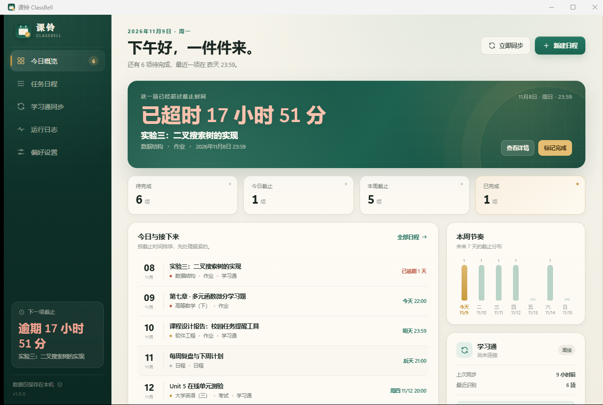

# 课铃 ClassBell —— 阶段二【项目四】校园痛点轻量化程序

> **项目四原文题目**：「**解决校园真实痛点的轻量化实用程序研发与日常运行日志验证**」
> **三项必交**：① 连续不少于 7 天的程序自动化运行日志（25 分）② 基于日志的至少 3 次 Git 迭代 Diff（20 分）③ 完整源码 + 8 位真实用户使用反馈（15 分）
>
> 我的切入点：学习通的作业分散在各门课里，容易漏；做一个常驻托盘的桌面提醒工具。

**直接下载试用**（Windows 10/11 64 位，**不需要提前装任何运行库**，安装器会自动检测并静默安装 WebView2）：

| 方式 | 下载 | 说明 |
|---|---|---|
| **安装版**（推荐） | [ClassBell-Setup-1.11.6.exe](https://github.com/yangswn/ICEC-2026-0157-LiZiYang/releases/download/v1.11.6/ClassBell-Setup-1.11.6.exe) · 34.0 MB | 双击安装、一路下一步，自动建快捷方式 |
| **免安装版** | [ClassBell-Portable-1.11.6.zip](https://github.com/yangswn/ICEC-2026-0157-LiZiYang/releases/download/v1.11.6/ClassBell-Portable-1.11.6.zip) · 32.1 MB | 解压即用、不写注册表；**zip 下载不会被浏览器拦** |

> ⚠️ **下载时 Edge / Chrome 可能提示「通常不会下载 ClassBell-Setup-1.11.6.exe」** —— 点右侧「…」→「保留」即可。
> 原因有两个：**没有购买代码签名证书**；文件刚发布、下载量低，微软的信誉系统还不认识它。**不是病毒。**
> 安装时若弹「未知发布者」，点「更多信息 → 仍要运行」。
> **不想走这两步的话，直接用免安装版 zip** —— 浏览器不会拦 zip，解压双击 `ClassBell.exe` 就能用。



---

## 一、现在的成绩（2026-11-22）

| # | 原文要求 | 分值 | 现状 |
|---|---|---|---|
| ① | **连续 ≥7 天** Telemetry Logs（每日同步进 `process_logs/`）| 25 | ✅ **14 / 7 天**（11-09 – 11-22，一天没断）|
| ② | **≥3 次** Git 迭代 Diff | 20 | ✅ **45 次**，每次都有独立提交和改动说明 |
| ③ | 源码 与 **8 位**真实用户反馈 | 15 | ✅ **8 位用户 / 25 条反馈**（2026-11-22 全部补齐）|

**三件最能说明这不是玩具的事：**

1. **3 位同学装不上 → 查因 → 两次迭代 → 3/3 全部能用了。** 0/3 → 3/3，人名、截图、每一条原始报错都在 `feedback/`。
2. **1 位同学读了源码，挑出 3 个真 bug** —— 月度重复的日期会永久漂移、编辑任务会清空已发提醒、补过期任务会立刻又生成"已逾期"。三处全修了，并新增 4 项回归测试。
3. **45 次迭代里有 9 次是我自测发现的**（导出点了没反应 / 登录窗口每 6 秒自己弹出来 / 16 条已交作业被误判成待完成 / 浮窗隐藏 30 秒又自己冒出来 / 隐藏后找不到恢复入口 / 错题本里公式图全裂 / 浮窗倒计时被截成「还有 1 天 01 …」/ 浮窗悬停时透明度不稳、晃动会闪 / 提醒弹窗把按钮裁掉了），不是用户报的。

> 三项都满了：日志多做了 7 天（要求 7 天），迭代 45 次（要求 3 次），用户 8 位 25 条（8 人都给过使用反馈）。

---

## 二、四十五次迭代（可核验）

> 想要按阶段看、带背景和结论的版本，见 **[`迭代汇报.md`](./迭代汇报.md)**（每次发版同步更新）。
> 下面这张表是逐条明细，用于核对提交。

> ⚠️ **表里的提交号属于主仓库 [`yangswn/ClassBell`](https://github.com/yangswn/ClassBell)，不是这个作业仓库。**
> 本仓库是作业仓库，`源码/` 是从主仓库同步过来的快照，所以在这里 `git log` 搜不到那些号 —— 不是编的。
> 核对方式：打开主仓库的 Commits 页搜索该号，或在本机 `git -C <主仓库目录> cat-file -t <号>`。

| 迭代 | 触发依据 | 主要改动 | 提交 |
|---|---|---|---|
| 第 1 次 · 基础可用 | 首次真实运行 | WebView2 主窗口、学习通登录、任务增删改、提醒弹窗、托盘、安装器、Telemetry | `cfee329` |
| 第 2 次 · 日志驱动修复 | 日志出现 `task_feed_error 403`、`added 0`、`candidates 30`，且重启后登录丢失 | H5 兜底、详情页补截止时间、已完成过滤、逾期保留、登录态恢复、品牌改名 | `4004a3a` |
| 第 3 次 · 长期任务与警示 | 27 条作业没有截止时间；用户反馈"过期无法补交" | 无截止时间自动转"长期任务"；新增"已错过/无法补交"状态、首页警示、同步警告、提前 1 天提醒 | `194257f` |
| 第 4 次 · 托盘行为 | 自己用的时候发现：点 × 直接退出，提醒就失效了 | 点 × 改为**隐藏到托盘**；补 `Ctrl+Alt+B` 召回与桌面「显示课铃」快捷方式（**因为 Win11 会把托盘图标折叠起来，不能只靠图标**）| `38ca387`、`80cfe6c` |
| 第 5 次 · 可读性与可退出 | 自己看久了发现字偏小；「退出」只能从托盘走，等于把退出藏起来 | **界面缩放六档**（90% / 100% / **110% 默认** / 125% / 140% / 160%，含 `Ctrl +/-/0` 快捷键，记忆选择）；**应用内「终止课铃」二次确认**；侧栏底部常驻红色终止按钮；运行日志并入偏好设置最下方 | `ccf9453`、`21f5cab` |
| 第 6 次 · 版本号单一来源 + 排序修正 | 版本号在 4 个地方各写一遍，改一漏三，一直显示 `1.0.x` 却分不清哪个是新包 | 版本号只由 `package.json` 一处定义，构建时自动同步到程序集 / 安装器 / 控制面板 / 界面 / 文件名，**并自动删掉旧安装包**；任务列表改为「未来 → 长期 → 逾期 → 已错过 → 已完成」，首页"下一项截止"优先取**未来**任务 | `b25d9ce` |
| 第 7 次 · 从「提醒作业」扩到「校园日常事务」 | 主动扩展：任务提醒只能覆盖"截止日期"这一类，而借还器材、错题复盘、通知聚合同样是高频且没有工具的事 | 新增三个模块：**通知中心**（线上提取失败时回退本地事件：逾期作业 / 已错过 / 逾期器材）、**器材借还核对**（登记 / 统计 / 排序 / 归还 / 逾期自动进通知）、**错题本**（按课程归档，区分自动识别与手动补录）| `61f1586` |
| 第 8 次 · 错题识别归因修正 | 1.0.3 里"检查 12 份、识别 0 道"被我记成"作业未批阅，属预期"。**实际去抓页面才发现是路径错了**：`task-work` 只是跳转页，真内容在它 JS 跳转后的 `doHomeWork?...&workAnswerId=...`；而且原逻辑只扫"已完成 / 已错过"，本地任务都是"待完成"→ 直接被跳过 | **跟随跳转**：从 `task-work` 解析出 `doHomeWork` 地址再读真正批改页；**不再限定任务状态**，只要有原链接就尝试；**新增「扫描当前作业页」**（用真实登录窗口打开的页面读取，比批量猜链接稳）| `8c0a293` |
| 第 9 次 · 会话持久化 | 错题扫描时登录态丢失、页面在 iframe 里读不到 | 持久化学习通会话；给错题扫描加 iframe 诊断，把"读不到"变成可定位的日志 | `9477fe5`（v1.0.6）|
| 第 10 次 · 链接与内联标签 | 登录窗口里点进课程后回不来；部分答案用内联标签而不是独立区块 | 登录窗口保留课程链接；解析内联形式的「正确答案」标签 | `9cffbab`（v1.0.7）|
| 第 11 次 · 自动识别与引导 | 手动逐个找课太麻烦；错题只记了答案没记原因 | 自动识别课程；错题增加"原因"字段；自动扫描改成引导式逐步确认 | `03baa15`（v1.0.9）|
| 第 12 次 · 安全加固 + WebView2 兜底 | ① **3 名同学下载后全部打不开**（缺 WebView2 直接崩，安装成功率 0/3）② 一份自查列出 14 项缺陷，其中 4 项 P0 属安全 | 见 7.1 与下方「安全加固」明细：Host 白名单、写请求三重校验、域名白名单改用 URL 解析、畸形 URL 兜底、未捕获异常先 flush 再退；**WebView2 缺失不再退出，降级到默认浏览器** | `3c6dd18`（v1.0.10）|
| 第 13 次 · 变成"懒人包" | 第 12 次只是不崩了，同学仍要自己去装运行时 —— **这一步不该由用户承担** | 安装器内置微软官方 **WebView2 引导程序**（1.90 MB）：装前读注册表检测，缺了就 `/silent /install` **静默装上**（最多等 180 秒），已有则跳过；装失败也不阻断课铃安装（启动仍降级到浏览器）| `b791e01`（v1.0.11）|
| 第 14 次 · 用户读代码挑出的三处逻辑缺陷 | **第 1 位真正用上的同学读了源码**，指出：① 月度重复的日期会永久漂移 ② 编辑任务会清空已发送提醒 ③ 补过期重复任务会立刻生成"已逾期"。另外提了一句"下次把注释写好" | ① 改为**锚点日**机制：始终从首期的日号取，1/31 → 2/28 → 3/31，**不再永久卡在 28 号** ② 只有**截止时间真的变了**才清空已发送提醒，否则只裁剪失效的键 ③ 补过期任务时**逐期滚到今天之后**再生成 ④ 三处都补了说明"为什么这么做"的注释，并新增 4 项回归测试（其中一条就叫 `monthly recurrence keeps the anchor day instead of drifting to 28`）| `3bb2b23`（v1.0.12）|
| 第 15 次 · 导出日志点了没反应 | 点「导出日志」时发现：既没落盘，也没报错 | 原来用网页 `<a download>` 触发下载，WebView2 在部分机器上会静默拦截。改成**宿主接管**：本地服务取内容 → 弹「另存为」→ UTF-8（无 BOM）写盘，并提示实际保存路径；取消时明确说"已取消保存" | `1162f31`（后统一改号 v1.1.3）|
| 第 16 次 · 界面发糊 + 日志满屏异常 | ① 小汪：「**界面好糊**」「不觉得对于用户来说，**ui 太小了吗**」② 他同一份日志里，8 次同步全是「作业接口异常」 | ① 查出宿主层在 WebView2 **已经跟随系统 DPI** 的情况下又乘了一次 `96/dpi`，小数二次缩放导致文字发虚 → 删掉这层补偿 ② 加**首次打开的字号引导**（6 档、点一下立即生效、只弹一次） | `bacfd9f`（v1.2.0/1.2.1）|
| 第 17 次 · 字号引导弹不出来 | 验证引导时发现：选项生成了，弹窗却不出 | 根因是把 `$$(...)` 写成了 `$(...)`，对单个元素调 `.forEach` 直接抛异常，后面的显示逻辑全断了。改成 `$$`，并调整成**先显示弹窗、再填内容**，任何一步失败都不会"静默不弹"；另加「设置页可重新打开引导」，不再靠删用户数据来验证 | `002eb84`（v1.2.2）|
| 第 18 次 · 403 一直显示成红色异常 | 小汪的日志截图：整页「作业接口异常」，他以为同步失败了，5 分钟内连点了 8 次 | 备用通道兜底成功的 403 标记为 `recovered`，**不计入错误数**；文案改成中性的「主接口 403（已用备用读取）」，并加三态标签（正常 / 已恢复 / 异常） | `6430162`（v1.2.3/1.2.4）|
| 第 19 次 · 字号引导每次启动都重弹 | **自查发现的**：弹过一次了，重启又弹 | 根因是本地服务**每次启动监听随机端口**，页面源（含端口）一变，`localStorage` 就等于换了一个存储空间。把界面偏好改存服务端 `settings`（与端口无关），顺带修好"上次停留的页面"重启后丢失 | `ffb563a`（v1.2.5）|
| 第 20 次 · 后台关不掉（"像流氓软件"）| 小汪：「**奶奶的，后台怎么关不了了原来那个**」「**还说不是流氓软件，**」 | **没有**把 `closeToTray` 默认改成 `false` —— 常驻托盘是到点提醒的前提，改掉等于把提醒功能关掉。改为：首次点 × 弹说明框（讲清为什么还在跑 +「立即退出」真退出按钮，只弹一次、标记存服务端）；托盘图标首次出现弹气泡；设置页加可见开关「关闭窗口时最小化到托盘」 | `6c3c05e`（v1.3.0–1.3.3）|
| 第 21 次 · 登录窗口反复自己弹出来 | **我自己反复点「扫描当前作业页」时发现的**，不是用户报的：登录窗口隔一会儿就自己冒出来 | 定位到 `scanLoginPage` 在登录窗口不存在时会 `ShowLogin()`，而自动扫描每 6 秒调一次 —— 等于**每 6 秒重开一次窗口**。加 `autoOpen` 参数：自动扫描传 `false` 绝不弹窗，只有用户主动点才允许打开；另修托盘图标可能没注册、轻提示在部分显卡/远程桌面不渲染 | `96696fc`（v1.3.4–1.3.8）|
| 第 22 次 · 老用户装不上新版 | 同学小陈从旧版升级到 1.2.4 时，安装器报「`runtime\node.exe` 正由另一进程使用」。他自己去任务管理器杀了 Node，结果「**关了后又出来了**」 | 根因是三条叠加：① 安装器覆盖文件前不检查旧进程 ② 课铃常驻托盘，点 × 只是隐藏，主程序还在 ③ `node.exe` 由主程序托管，**杀掉会被立刻重启** —— 所以杀 node 必然无效。改为：安装前检测安装目录内的进程 → 弹窗「课铃正在运行（共 N 个进程）」→ 按**先主程序、后 node** 的顺序关闭（顺序反了会被重启）；**只按路径匹配**，还额外要求 node 在 `runtime\` 子目录下，**不会碰机器上其他的 Node 程序**；自动关不掉时降级为手动指引 + 重试，不静默失败 | `429d1c9`（v1.3.9）|
| 第 23 次 · 两个课铃抢同一个数据目录 | **我自己装机时撞到的**：装好 1.3.9 一启动就弹「课铃启动失败：已中止操作 (0x80040004 E_ABORT)」，但日志显示 Node 服务已经起来、窗口也建好了 | 定位为两件事叠加：① WebView2 的 UserDataFolder **同一时间只能被一组进程独占**，当时另一个课铃（别的目录的便携版）正占着它 ② 用户看到的只有一句英文 HRESULT，根本不知道发生了什么。改为：启动时**在 WebView2 初始化之前**抢命名互斥体 `Local\ClassBell.SingleInstance`，抢不到就提示「课铃已经在运行」后退出；同时把启动异常翻译成人话（已有实例 / 缺 WebView2 / 无写入权限），识别不了的才显示原文 + 日志目录。**便携版与安装版共用同一个锁名** | `1.4.0` |
| 第 24 次 · 升级把用户数据删了 | 「安装前先卸旧版」上线后，覆盖安装时旧卸载器的 `timeout 2 & rmdir /s /q` 延迟删除，把刚解压的文件连同 `data\` 一起删了 | 根因是我给旧版卸载器传了它**不认识的** `/KEEPDIR`（旧 `Uninstall.exe` 按老逻辑删整个目录），而安装器只等 2.5 秒就收工。**这次事故删掉了我本机的 34 项任务、学习通登录态和 11-09–11-12 的日志**（日志在作业仓库有副本已恢复；任务靠重新登录同步找回）。修复：备份 → 卸载 → 轮询到目录确实消失 → 再等 2.5 秒 → 解压 → 恢复；备份加**校验**（文件数 + 字节数），校验失败就**中止安装**而不是硬装；备份滚动保留 2 份；恢复只补缺失文件。补了 5 条契约测试（"备份必须在卸载之前""校验失败必须 throw"）| `1.4.1`–`1.4.3` |
| 第 25 次 · 推倒重来：不卸载，直接覆盖 | 复盘第 24 次时想通一件事：**「先卸载再装」这个思路本身就是错的** —— 卸载器是为"把这个软件删掉"设计的，不是为"换个版本" | 标准做法是覆盖安装（Inno Setup / NSIS / MSI 升级时都不调卸载器）。整套删掉：`UninstallPrevious`、`WaitForDirectoryRemoved`、`Sleep(2500)`、所有对 `Uninstall.exe` 的调用，**代码净减约 100 行**。加三层保护：只读文件先清属性 → 覆盖失败 300ms×5 重试 → 仍失败则带上文件路径中止（宁可"没升级成功"，也不留"装了一半"）。数据目录全程不碰 | `1.5.0` |
| 第 26 次 · 查了 28 条"没时间"的作业，发现 16 条其实早就交了 | **我盯着自己的数据看**：34 条待办里有 28 条没有截止时间，怀疑是抓取漏了字段 | 探到学习通作业详情页（H5 `work/phone/task-work`）里确实写着「截止时间」和「共包含 30 道题目」，于是做了一轮详情页补全。**结果补到 0 条截止时间** —— 那 28 条全是已提交/已批改的作业，平台上本来就没有这个字段。**但顺手挖到真问题**：列表每行有 `status` 属性（1=未做 / 2=过期未提交 / 4=已批改），之前只按文案判断，而"已批改"那行只显示分数、没有文案，于是被当成未提交 —— **16 条早就交了的作业一直挂在"待完成"里**。修完：待完成 22 → 12。同时拿到 8 条题量（「专题测试 30 题」vs「工作页 1 题」），为以后估算工作量打底 | `1.6.0` |
| 第 27 次 · 同学第二次读源码，挑出 3 处「静默」问题 | 小臻又通读了一遍源码，指出三处：① `new Date('2026-02-30')` 不报错、静默变成 3 月 2 日 ② `POST /api/tasks` 传空 body 直接抛 TypeError ③ 月度重复任务把 15 号改成 20 号，下一期又跳回 15 号 | 三条的共性都是「**不报错，但结果和用户以为的不一样**」。① 拆成读/写两个入口：读旧数据超界返回 `null` 不进位，写路径抛 `INVALID_DATE` 并 400；② 17 处写接口统一改用 `readJsonObject`，store 层再加一道；③ **挖到的根因比反馈还深一层** —— `updateTask` 合并 `{...existing, ...patch}` 时把旧的 `recurrenceDay` 一起带进去了，`normalizeTask` 当成"调用方显式指定"，锚点日于是永远是旧的。修法：patch 没给就从合并对象里删掉，`dueAt` 真变化且为月度时让锚点日跟随；前端加确认弹窗说明"会应用到之后每一次" | `1.6.1` |
| 第 28 次 · 右键托盘第一次打开窗口、第二次才出菜单 | **我和同学小陈都以为「托盘没有退出键」**，实际是第一次右键被窗口抢了焦点，第二次才轮到菜单 | 根因：`NotifyIcon.Click` **不区分左右键**，右键也会触发 `ShowMain()`，窗口一被顶到前面就抢走焦点，`ContextMenuStrip` 那一次弹不出来；第二次右键时窗口已经在前面，菜单才正常。改成 `tray.MouseClick` + **只响应左键**，双击单独绑定（`ShowMain` 幂等，连发不会闪、不重载）。加了 4 条静态契约测试：禁止 `tray.Click` 再出现、`MouseClick` 里必须有左键判断。**这个 bug 存在很久没人发现，因为我自己测的时候从来只点左键** | `1.6.2` |
| 第 29 次 · 估时太慢太吃内存 → 默认不调模型；安装目录不再漂 | 1.7.0 的估时默认调本机模型：整批 11 条要 **29.5 秒**、吃 **5–6GB** 内存（7B）。而实测**有题量时它和规则估得一模一样**（30 题都是 45 分钟），差异只在「1 题的工作页」上 | 估时改成**默认只走规则**（6 毫秒、0 内存），模型降级为设置页开关、默认关闭、只用 1.5b。同时修安装目录漂移：1.6.2 装到了 `AppData\Local\ClassBell`，而快捷方式仍指着 `AppData\Local\Programs\ClassBell`（里面是 1.5.0）—— **点图标打开的是旧版，用户以为新版没改任何东西**。现在目录固定在注册表 `InstallLocation`，装完强制重写所有课铃快捷方式并**回读 TargetPath 校验** | `1.8.0` |
| 第 30 次 · 打开模型开关就弹红字 | 开关一打开就去探测模型，没装就弹「没有找到 qwen2.5:1.5b」，之后每次点预算还要再弹一次 —— 用户只是拨了个开关，却被告知"你错了" | 开关只负责切换，**不探测、不弹 toast**；状态改成开关下方一行常驻文字（有模型「✓ 已就绪」/ 没模型「⚠ 未检测到 · 复制安装命令」）；`MODEL_NOT_READY` 时**静默跳过**。顺带发现 WebView2 里 `navigator.clipboard` 与 `execCommand('copy')` **两条路都被拒**，改走宿主进程的 `Clipboard.SetText` | `1.8.1` |
| 第 31 次 · 用户说「存在感太低」→ 加桌面浮窗 | 小廖反馈：「**感觉他的存在感太低了**」「平时使用往往都是把它**挂在后台**」「没有一个浮窗」。而小汪之前说「界面太小」—— 两个人、同一件事：**看不见就想不起来用** | 加无边框置顶小窗，显示「下一项任务 + 倒计时」，可拖动、记住位置、双击打开主界面。**全屏自动隐藏**、不抢焦点、可关闭。实测拖拽 / 全屏让路 / 150% DPI 缩放；自己修掉三个真问题：右键菜单拿不到焦点卡住不收、子控件不继承菜单、拖动时 `Capture` 打断双击 | `1.9.0` |
| 第 32 次 · 「隐藏浮窗」是个假按钮 | 用户实测：点隐藏 → **最多 30 秒又自己冒出来**；而且隐藏后**没有任何入口能叫回来**，只能去设置里关开关再开，还要等 30 秒 | 把「启用浮窗」（长期，写盘）和「这次不想看」（临时，进程内，重启恢复）**拆成两个状态**，`SyncFloatWindow` 必须同时判。托盘右键菜单加「桌面浮窗」勾选项作为恢复入口；设置开关改即时生效；隐藏时 toast 告诉用户怎么找回。顺带修了重开后位置丢失 | `1.9.1` |
| 第 33 次 · 重复任务把上一期的「做完了」状态带进下一期 | 小臻上周日读源码发现：`nextOccurrence()` 用 `...task` 复制上一期后手写重置，**漏了 1.7.0 新增的 `startAt` 和 `actualMinutes`**。他说「跟上次」—— 确实是**第三次**同类问题（1.6.1 的日号、1.6.3 的起始月） | 后果比前两次严重：`startAt` 让下一期显示「进行中」；`actualMinutes` 让**估时的历史层拿到复制数据当样本**，越用越偏而且看不出来。修法没停在补两行 —— 改成集中重置表 `OCCURRENCE_RESET`，以后加字段只改一处；顺带收了 `estimateDay`（"今天已估过"的日期键也不能跨期）。149 项测试，其中一条直接断言「带 actualMinutes 的样本只有 1 条」 | `1.9.2` |
| 第 34 次 · 「改回待完成」也没清开工时间 —— 同一类问题的第四个入口 | 小臻说「**没改啊哥**」：`restoreTask` 只清了 `status` 和 `completedAt`，`startAt` / `actualMinutes` 还留着，任务改回待完成后仍显示「进行中」 | **全路径排查找到 4 处，真正写 `pending` 的有 2 处**（`restoreTask` 和**编辑弹窗保存**），它们走同一段代码 —— 所以修复落在 `updateTask` 的状态转换分支，并加 `existing.status !== 'pending'` 判断（防止编辑一条正在进行的任务时把开工时间抹掉）。顺带把 `floatWindowPos` 两端都限在 ±100000，修掉 `Math.Abs(int.MinValue)` 抛溢出的坑，并把位置解析抽成独立文件，**让它能真正被编译执行测试** | `1.9.3` |
| 第 35 次 · 错题本：我一开始判断「做不了」，其实是从没查过批改页 | 想做「做完之后把系统判错的题记下来」。上一次的判断是不做，理由很硬：作业列表只能拿到「交没交」，拿不到「哪题错了」 | 这次真去请求了一次批改详情页 `selectWorkQuestionYiPiYue`：**每道题的正确答案、我的答案、得分、答案解析全是现成 HTML**。判错也不用猜分数 —— 学习通自己给答错的题打了 `wrongRed` 类名。做成「骨架页拿作答 ID → 满分作业跳过 → 详情页一次拿整份」，52 道题里归档出 17 条错题，**全程不涉及任何 AI 判断** | `1.10.0` |
| 第 36 次 · 错题本里公式图全是裂图 | 我装上新版打开错题本，数学题的公式图全显示成「题目图片」占位 | 根因不在图片地址，在页面安全策略：`img-src 'self' data:` 只允许同源图片，而学习通图床是外部域名。另外实测图床对**没有 UA 的请求直接 403**，还有一部分图是 `http://`（混合内容会被拦）。修法是加本地图片代理，**CSP 一个字没改**；代理只放行学习通域名，302 跳转后还会复检最终地址 | `1.10.1` |
| 第 37 次 · 提醒弹窗在部分机型上显示不完整 | 我反馈：标题一长就折行，折行后下面两行被挤掉；而且弹窗字号没法调 | 原来 `ClientSize` 写死 `392×116`、三个 Label 全用固定坐标、字号固定 11F/9F —— 标题折两行就把下面挤没了。改成**按实测文字高度算窗口高度**，并抽成独立的 `ToastLayout` 计算模块，探针程序可以按不同缩放和 DPI 直接验证 | `1.10.2` |
| 第 38 次 · 字号要的是「三处各自可调」，不是「合成一个」 | 1.10.2 把三处字号并成一个「界面大小」，想调小浮窗就得牺牲整个界面 —— 我把需求理解错了，用户要的是**控件放一起、数值各自独立** | 拆成 `uiScale` / `floatScale` / `toastScale` 三个独立设置，设置页用一个网格排三行，每行 6 档 + 自己的当前值；宿主也拆成两个读取方法，互不串用。实测 0.9 档窗口 608×170、1.1 档 743×209、1.6 档 1080×303，比例精确等于档位比 | `1.10.3` |
| 第 39 次 · 浮窗只显示一条，时间相近的看不见 | 我反馈：「只能显示一条，不够看的。有的时候你还有别的任务要完成，时间相近，你没法同时看见」 | ① 显示条数可设 1–3 条；② 排序改成「优先级降序 → 截止时间升序」，原来只按时间排、紧急的排不到前面；③ 透明度从写死 0.92 改成 30%–100% 连续可调 —— 圆角靠 `Region` 裁、`Opacity` 管透明，两者本来就能共存 | `1.11.0` |
| 第 40 次 · 滑杆松手才生效，判断不了合不合适 | 我试滑杆时发现：「拉杆跟手，但是浮窗不是时时跟手的，完成之后才会显示透明度，没法判断是否合适」 | 拖动时走独立预览通道（只发宿主消息、不写设置），`requestAnimationFrame` 合并 + 值没变不发；松手才落盘。顺带把浮窗提到最前，避免被主界面挡住。实测拖动期间 `data.json` 修改时间一字没变 | `1.11.1` |
| 第 41 次 · 倒计时被截断、恢复残留下一期、重复任务各占一格 | 我截图反馈「时间提示看不到完整的」；又说「这两个任务某种意义上是同一个，只不过他被设置为每天进行的任务，这种就没必要重复了，要把位置让给其他的」 | ① 倒计时不再靠截断，改成先量时间宽度、标题让位；② 查日志发现是「完成→恢复」残留：完成时派生了下一期，恢复只改状态没撤销派生 —— 于是 `restoreTask` 增加撤销（只在 pending、无 `startAt`、无耗时时删，且必须是直接后继）；③ 浮窗按 `seriesId` 分组，同系列合并一格 + 小字标「下次 …」，顺带补上根节点的 `seriesId` | `1.11.2` |
| 第 42 次 · 浮窗悬停高亮不稳：不是每次都变 100%，在里面晃动会闪 | 我实测：「光标选中浮窗的时候，并不是每次都会透明度调整为 100，晃动光标在浮窗上（没有划出去）都会不停的闪」 | 根因是只重写了窗体的 `OnMouseEnter/OnMouseLeave`，而浮窗几乎全被 Label 盖住：光标落进 Label 时窗体收不到 Enter；Label 之间移动时 WinForms 会先发 Leave 再发 Enter，透明度被反复切换。改成 50ms 轮询光标位置 + `Region.IsVisible` 判定（圆角外不算），只在状态翻转时改值 | `1.11.3` |
| 第 43 次 · 提醒弹窗把按钮裁掉了 | 我截图问「这是？」，随后指出显示不全。我第一版判断是把 `Height = 304` 改成 348 | **这个判断是错的**：304 是物理像素，150% 缩放下只剩 203 个 CSS 像素，加到 348 也还是不够。dsh 没有盲从，改成「设计尺寸 × Win32 DPI」，在 150% 下复现并修好 | `1.11.4` |
| 第 44 次 · 修好 DPI 反而在副屏出现大片空白 | 我先说「还是一样」，查出运行的其实是 12:59 的旧包，改动根本没进安装包；DPI 修好后，弹窗挪到 100% 副屏又变成窗口过大 | 不再问 Windows，直接问页面：物理尺寸 = 设计 CSS 尺寸 × `window.devicePixelRatio`；定尺寸前 `Opacity=0` 防闪，2 秒兜底，换屏重算。主屏 150% 660×456、副屏 100% 440×304，CSS 视口恒为 440×304，主副屏都实测过 | `1.11.5` |
| 第 45 次 · 修好尺寸后还剩「透明占位」和「换屏一帧」两个尾巴 | 我在核对 1.11.5 时提出：定尺寸前窗体要透明最多 2 秒、拖到别块屏会有一帧按旧尺寸 | 去掉透明占位与 2 秒兜底，改成**显示前**就用目标屏 DPI 算准（`GetDpiForMonitor(MonitorFromPoint(光标所在屏))`）；`OnDpiChanged` 用 `e.DeviceDpiNew` 同步改；dpr 校验降级为异步、不一致才重排。200% 用 CDP 模拟补测 | `1.11.6` |

辅助提交：`6df976c`（文档与截图）、`a9bb36c`（真实日志与 7 天索引）、`1e0911b`（Git 迭代记录整理）、`13c370a`（版本号改用语义化版本）、`c6ee484`（单向同步脚本）

> 📌 **版本号与迭代数不是一一对应**：`1.0.5`、`1.0.8` 两次只重新打包、没有独立提交（跳号）；
> `13c370a`（版本号改用语义化版本）和 `c6ee484`（单向同步脚本）属工程规范，不算功能迭代。
> 所以「**45 次迭代**」指的是上表里 **45 条迭代记录**，每条都对得上一个版本和一次具体改动。
> 它不等于提交数：仓库目前共 **64 个提交**（`feat` 19 + `fix` 28 + `docs` 11 + `chore` 3 + `release` 2 + `refactor` 1），
> 其中文档、发布与工程维护类不计入功能迭代，而个别版本又拆成了多次提交 —— 所以 45 与 64 不相等，这是对的。
> 想核验就看上表：第 1 条到第 45 条，每条都标了版本号，能在 `git log` 里找到对应的改动。

### 第 12 次的安全加固明细（4 项 P0 + 相关项）

| 缺陷 | 修法 | 验证 |
|---|---|---|
| 无 Host 校验，DNS rebinding 可读全量数据 | 只接受 `127.0.0.1:<端口>` / `localhost` / `[::1]` 三种 Host | 伪造 Host → **403** |
| 跨站 `text/plain` 写入（CSRF） | 写请求必须 `Content-Type: application/json` + `Sec-Fetch-Site` 同源 + `Origin` 校验（三重） | 跨站 POST → **403** |
| `/api/mistakes/inspect` 域名白名单可绕过 | 改为 URL 解析后严格匹配 `chaoxing.com` 及其子域 | `evilchaoxing.com` → **400** |
| Cookie 可被跨站读取 | `sec-fetch-site: cross-site` 直接拒绝 | → **403** |
| 畸形 URL（如 `/%`）导致请求永久挂起 | `decodeURIComponent` 加 try/catch + 静态兜底 | 立即返回，不再挂起 |
| 未捕获异常直接退出、日志丢失 | 记录 → flush → 再退出 | — |

**代码依据**（可自行核对）：`server/server.js` 的 `ALLOWED_HOSTS` 与 `crossSiteWrite()`，
`desktop/MainForm.cs` 的 `ShowBrowserFallback()`。

**完整的人机协作过程**（怎么问的、AI 找出了什么、哪些判断是我下的）见
→ `03-AI-Collaboration/2026-11-10-用云端AI做安全审计.md`

**这一条的触发点值得单独记**：14 项缺陷不是"感觉哪里不稳"，而是对着实际代码逐条走查、
并用真实请求验证出来的；4 项 P0 全都指向同一条路径 —— **本地 HTTP 服务被外部网页滥用**。

> **本地程序不等于安全。** "只监听 `127.0.0.1`"挡不住 DNS rebinding：
> 恶意页面可以把自己的域名解析到回环地址，再用外来的 `Host` 头访问这些接口。
> 所以光绑地址不够，**还得校验 Host、校验来源**。

**前 6 次是「被问题推着改」**：日志里的 `403`、用户反馈的"过期无法补交"、自己用出来的"点 × 就退出""字体偏小""版本号对不上"—— 都不是"我想加功能"。

**第 7 次是主动扩展。** 通知中心 / 器材借还 / 错题本这三块，验证**全部来自我自己试用，还没有外部用户碰过**。它的性质更接近"先做出能力，再拿去问人要不要"。

**第 8 次又回到「被问题推着改」，而且是最值得记的一次 —— 它推翻了我自己前一版的解释。**

1.0.3 里我写的是「检查 12 份、识别 0 道，属预期（当时作业都未批阅）」。**这个归因是错的。** 实际去抓页面才看到两件事：

1. `work/phone/task-work` 只是**跳转页**，真内容在它 JS 跳转后的 `doHomeWork?...&workAnswerId=...`；
2. 原逻辑只扫「已完成 / 已错过」，而本地任务都是「待完成」→ **直接被跳过**。

→ **不是"没有错题"，是"根本没读到答题页"。**

> **一个功能返回 0 时，「0」可能是"真的没有"，也可能是"根本没读到"。两者外观一样，处理方式完全相反。**
> 这次是后者。我把这个区别写在这里，是因为以后还会遇到同样的情况。

> 第 4 次的触发点值得单独说：**如果点 × 就退出，那天的日志会断**——一个界面小毛病，直接威胁「连续 7 天」这条硬要求。改的不是外观，是**让日志能连续产生**。

---

## 三、当前真实数据（2026-11-17）

| 项 | 数值 | 来源 |
|---|---|---|
| 日志事件 | **5,568 条** | `process_logs/` 下 10 个 jsonl 合计 |
| 错误记录 | 411 条 | 主要是学习通 `task_feed` 返回 **HTTP 403**，每次同步走一次 H5 降级 |
| 同步次数 | 411 次 | `sync_start` 事件 |
| 活跃天数 | **10 天** | 11-09 – 11-18，`process_logs/` 一天一个 |
| 安装包 | `ClassBell-Setup-1.11.6.exe`（35,681,280 字节）| 已发布到 Release，可直接下载 |
| 单元测试 | **268 项，全通过** | `node tests/run-all.js` 实跑：268 pass / 0 fail |
| 登录识别 | **17 门课程 / 36 条作业** | 学习通同步结果 |
| 现有数据 | 40 项任务（待完成 15 / 已完成 22 / 已错过 3）/ **17 道错题** | `data.json` 实测 |

**错题本（1.10.0 新增）**：从学习通批改页归档错题，每题带题干、选项、正确答案、我的答案、得分和解析。
判错用的是学习通自己的 `wrongRed` 标记，不靠"得 0 分"去猜，主观题给部分分也不会误判。

---

## 四、技术路线与三个真实坑

**技术栈**：C# WinForms + WebView2 + Node.js 本地服务（放弃 Electron）

**坑 1：学习通原生接口 403**
`gas/taskmsg` 直接返回 403 → 改为退回 H5 作业列表，再对没有截止时间的作业**逐条打开详情页补全**。
→ 这是"接口不可用时的降级路径"，也是第 2 次迭代的直接来源。

**坑 2：重启后登录态丢失**
Cookie 改由本机保存，重启自动恢复。
→ 这是第 2 次迭代的另一半。

**坑 3：错题本 —— 我判断「做不了」，其实是从没查过那个页面**
一开始否掉的理由很硬：作业列表只能拿到「交没交」，拿不到「哪题错了」。后来真去请求了一次批改详情页，才发现系统早把题干、正确答案、我的答案、得分、解析全渲染在 HTML 里，连「哪题错了」都自带 `wrongRed` 类名。
→ 教训：**「我没看到」和「不存在」不是一回事。** 判断一个功能不可行之前，先确认自己真的查过那边的数据 —— 这跟第 26 次那次误判是同一类错误。

---

## 五、还差什么（按紧急度）

1. ✅ **让试用同学装上并真的跑起来** —— 已闭环。v1.0.11 起安装器会自动装 WebView2（见 7.1）。**原来打不开的 3 位同学（小刘、小杨、小亮）现在全部能打开并使用**：0/3 → 3/3。
2. ✅ **8 位真实用户反馈**（15 分）—— **已满 8 位**（小刘、小杨、小亮、小臻、小汪、小陈、小李、小廖），共 **25 条反馈**。
   ✅ 2026-11-22 回访补齐：小杨（"挺实用"）、小亮（"不用打开学习通就知道要补什么"）、小陈（"增加了退出键，挺好的"）都给了使用反馈，**8 位全部有使用感受**。
3. ✅ **连续 7 天日志**（14 / 7，11-09 – 11-22 十四天一天没断）。要求 7 天，实际做到 14 天 —— 7 天是**连续**门槛，中间断一天就要从断点重新数。
4. 🟡 自述未修的三项：提醒队列上限 20（未改 SSE）、Cookie 明文落盘（未加 DPAPI）、端口冲突无握手提示
5. ⬜ **课程表未做同步** —— 原文没强制，但**小汪主动要了**：「提醒我们现在是什么周」「第几周」「上什么课」「在哪里上」「只有作业还是太少了」。这条原本是可选项，现在有真实用户提出，优先级应该前移。见反馈表第 10 条。

---

## 六、目录说明

```
课铃-ClassBell/
├── README.md                    ← 本文件：原文对照与现状
├── 源码/                        ← 课铃 1.2.5 完整源码（110 个文件）
├── feedback/                    ← 用户反馈截图（4 张）
├── 2026-11-09-首次可运行总结.md    ← 当日总结原文存档
└── 用户反馈-收集表.md             ← 8 位用户的收集模板与话术
```

> 源码就在本目录 `源码/`；带完整 Git 历史（38 次提交）的版本在 `yangswn/ClassBell`。
> 每日运行日志在 `02-20Days-Challenge/process_logs/`。

---

## 七、安装包怎么发（不进 Git 仓库）

`campus-pulse/.gitignore` 里已经排除了 `dist/` —— **这是对的，别改。**

> 33 MB 的 exe 每改一次都进一次历史，仓库很快会变得没法 clone。**安装包用 Release 挂，源码留在 Git 里。**

**发布用 GitHub Releases**（在仓库页面右侧「Releases → Create a new release」）：
把它当附件上传，README 里贴下载链接即可。

---

### 7.1 WebView2 依赖问题（2026-11-10 **3 名同学同时**撞出，两次迭代解决）

> **不是个例**：3 位同学分别下载安装包，**全部**报同一个错，其中 1 人提供截图。
> 三台机器的环境各不相同：小刘是在**虚拟机**里跑的（干净镜像本来就不带运行时），小杨、小亮是普通电脑但系统里没有这个运行时。
> 安装成功率 **0 / 3** —— 这也说明问题在环境普遍性上，而不是某台机器特殊。
>
> **修复后复测：3 / 3 全部能打开并使用。** 这三个人后来又都装了新版（1.2.x），没有再报错。

**原始现象**（v1.0.4 及更早）：双击后弹窗「课铃启动失败：`Couldn't find a compatible WebView2 Runtime installation to host WebViews`」，然后退出。

**原因**：课铃界面是 **C# WinForms 外壳 + WebView2 渲染**，目标机器必须有 WebView2 Runtime。
Win11 一般自带；**Win10、精简系统、Ghost 系统、Windows 沙盒不一定有。**

#### 解决过程（两版，各解决一半）

| 版本 | 做了什么 | 解决了什么 | 还缺什么 |
|---|---|---|---|
| **v1.0.10** | 缺失时**不再退出**，降级到默认浏览器打开 `http://127.0.0.1:<端口>` | "打不开"变成"能打开" | **用户仍要自己去装运行时** |
| **v1.0.11** | 安装器内置 **WebView2 引导程序（1.90 MB）**，装前检测 → 缺了就 `/silent /install` **静默装上** | **用户什么都不用准备** | 需要联网（引导程序在线拉取） |

**v1.0.11 的安装流程**：双击 → 检测注册表 `pv` → 缺失则静默安装（**最多等 180 秒**）→ 装课铃 → 建快捷方式。
**装 WebView2 失败也不阻断课铃安装**（启动仍降级到浏览器）。本机实测：已有运行时时 **1 秒**跳过。

**代码依据**：`installer/Setup.cs` 的 `WebView2Installed()` 与 `EnsureWebView2()`；
引导程序在 `tools/MicrosoftEdgeWebview2Setup.exe`（1,897,688 字节，随源码一起进 Git，可重建）。

**这条反馈的完整处理过程**（含我第一版只修一半的判断失误）见
→ `03-AI-Collaboration/2026-11-10-WebView2-两次迭代.md`

#### ⚠️ 一个必须说清的边界：**降级 ≠ 等价替代**

> **课铃的桌面弹窗提醒（`ReminderForm`）本身也是 WebView2 渲染的。**
> 没有运行时的机器，**只能在浏览器页面里看任务和改设置，收不到桌面弹窗。**
>
> 而"桌面弹窗提醒"恰恰是这个工具的核心价值。

→ 所以 v1.0.11 的自动安装很重要：**只有运行时真的装上了，核心功能才在。**
→ 如果目标机器**完全离线**（连引导程序都拉不到），需要再出一个内置 150 MB 离线运行时的 `-offline` 版本。

#### 仍然可能遇到的情况

| # | 情况 | 做法 |
|---|---|---|
| 1 | 自动安装因网络失败 | 手动装：`https://developer.microsoft.com/microsoft-edge/webview2/` → Evergreen Bootstrapper → 几秒完成，**不用重启** |
| 2 | 装完仍报错 | 可能下成 32 位包或版本过旧 → 改用 **x64 Standalone Installer** 覆盖安装 |
| 3 | **日志路径出现 `C:\Users\WDAGUtilityAccount\`** | ⚠️ 该机器在 **Windows 沙盒（Sandbox）** 里运行。沙盒是干净镜像、通常不带 WebView2，**且关机即清空** → **让他在正常桌面直接运行，别在沙盒里测**（否则装了也白装） |

**自查有没有装**：`Win + R` → `appwiz.cpl` → 搜 `WebView2`。

---

**当前安装包信息**：

| 项 | 值 |
|---|---|
| 文件 | `ClassBell-Setup-1.11.6.exe` |
| 大小 | **35,681,280 字节**（34.0 MiB）|
| 下载 | <https://github.com/yangswn/ICEC-2026-0157-LiZiYang/releases/download/v1.11.6/ClassBell-Setup-1.11.6.exe> |
| 内容核查 | 不含 cookie / session / profile 等登录态数据 ✅（1.0.0 已核）|

> **哈希不写在这份 README 里。**
> 原因：开发过程中同一个版本号会重新打包多次，每次哈希都变，写死了就会立刻失效。
> **做法：谁发布谁写 —— 哈希写在 GitHub Release 的说明里，对着当次上传的那个文件。**
>
> （记录一下当前这次构建是 `e6a3e859…`，但它只对“这一次打包”有效，不作长期凭据。）

**1.0.12 的行为要点**：

- 点右上角 × → **隐藏到托盘**，提醒继续有效；找回用 **`Ctrl+Alt+B`** 或桌面「显示课铃」
- 彻底退出 → 侧栏底部红色「终止课铃」，或偏好设置 → 界面与退出 → 终止运行（**有二次确认**）
- 界面缩放 **六档**：小 90% / 标准 100% / **大 110%（默认）** / 特大 125% / 超大 140% / 巨大 160%
  还支持 `Ctrl +` 放大、`Ctrl -` 缩小、`Ctrl 0` 回标准
- **通知中心**：未读数显示在导航徽标；可逐条已读 / 全读 / 删除，也可手动添加
- **器材借还核对**：登记借出 → 统计「借出中 / 逾期未还 / 已归还」→ 列表按「逾期 → 借出中 → 已归还」排 → 一键归还；**逾期器材自动进通知中心**
- **错题本**：按学习通课程归档，每条含「我的答案（红）/ 正确答案（绿）/ 解析 / 考点标签」；可筛选、可手动补录；自动归档时**跳过答对的题**。读取路径已修正为「跟随 `task-work` → `doHomeWork` 跳转」，并有「**扫描当前作业页**」这条保底路径
- **v1.0.10 起：缺 WebView2 不再崩溃** → 自动降级到默认浏览器打开（但降级后**没有桌面弹窗提醒**，见 7.1）
- **v1.0.11 起：安装器自动装 WebView2** → 内置官方引导程序，缺失时 `/silent /install` 静默装上，**对方双击即可，不用自己准备运行库**
- **v1.0.12 起：重复任务不再漂移** → 月度重复按**锚点日**推算（1/31 → 2/28 → 3/31）；补过期任务会**滚到今天之后的下一到期日**，不再立刻生成"已逾期"；编辑任务只在截止时间变了才重置提醒
- **v1.0.10 起：本地服务加了来源校验** → Host 白名单 + 写请求三重校验（详见「第 12 次迭代」安全明细）

> **三处已知限制（写在这里，以免被误读成"全都自动搞定"）**
>
> 1. **学习通通知没有公开稳定的接口。** 尝试了三个已知地址，失败时**回退本地事件**（逾期作业、已错过、逾期器材），所以"取不到线上通知"时，本地提醒照常生成。
> 2. **错题的批量归档仍受学习通限制。** 实测我账号的 `doHomeWork` 直接访问会返回"信息提示"页 —— 这是学习通对非浏览器上下文的限制。所以批量模式可能仍只扫到少量，**需要用「扫描当前作业页」这条由真实浏览器打开的路径**。若某页把答案放进图片或单独弹窗，整页文字读取也会取不到，那时只能手动补录。
> 3. **v1.0.10 里这三项仍未做**：提醒队列上限 20 且依赖宿主轮询（只加了丢弃计数与日志，没改成 SSE 推送）；**Cookie 仍明文落盘**（只做了来源隔离，没做 DPAPI 加密）；端口冲突时服务端没做握手失败提示。

> 哈希的用处是让下载的人核对文件没被替换。所以它必须**一对一绑定某一次上传**，
> 这也是为什么它该写在 Release 里、而不是写在会一直改的 README 里。

---

## 八、源码与日志怎么放

| 内容 | 放在哪 | 说明 |
|---|---|---|
| **源代码** | 本目录 `源码/`（1.2.5，110 个文件）| 含 `desktop/` `server/` `src/` `docs/` `tests/` `installer/` `tools/`；已排除 `node_modules`、`dist`、`.git`。**含 `tools/MicrosoftEdgeWebview2Setup.exe`，可重建安装包** |
| **完整提交历史** | 独立仓库 `yangswn/ClassBell`（38 次提交，私有）| 本目录的 `源码/` 是导出快照，不带历史，**Commit 与 Diff 核验看那个仓库** |
| **每日运行日志** | 本仓库 `02-20Days-Challenge/process_logs/` | 对应原文「每日同步进 process_logs/」|

> **两处都有，是为了互补**：`源码/` 让评审在一个仓库里就能逐个点开文件；`ClassBell` 提供可点击的 38 次提交与 Diff，能看出每一次改动的动机。

---

## 九、每天只做两件事（14 天，断一天就重数）

**① 打开课铃跑一次**（哪怕只看一眼，也要让它产生当天日志）

**② 跑同步脚本**

```bash
bash ~/syncbell.sh
```

脚本会：把当天 `.jsonl` 与 `index.json` 复制进 `process_logs/` → 自检天数 → 提交推送。

**看到 `## main...origin/main`（没有 `ahead N`）就是成功。**

---

*最后更新：2026-11-19*
