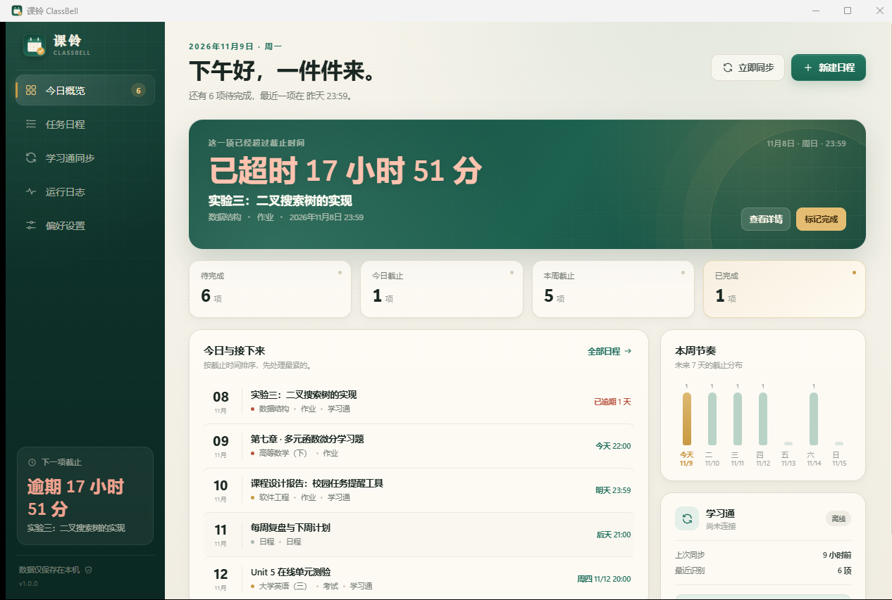
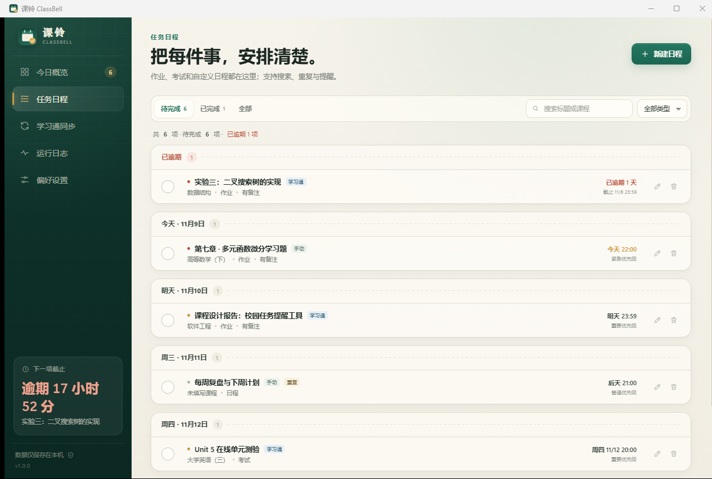
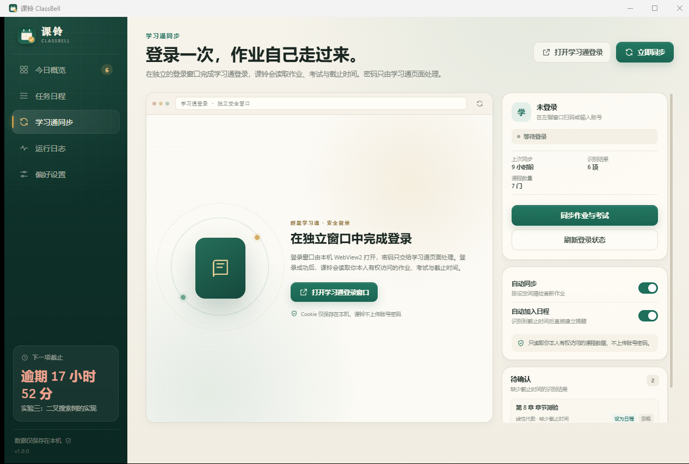
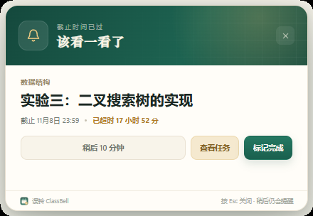

# 课铃 ClassBell

> 把该做的事放在眼前，剩下的交给课铃。

课铃是一个面向大学生的 Windows 轻量课程任务提醒工具：登录学习通后自动读取作业、考试与截止时间，也可以完全离线手动记录课程日程；到期前通过桌面弹窗、托盘和声音提醒。此外还提供通知提取、器材借还核对和按课程归档的错题本。



## 功能

- **学习通同步**：独立登录窗口完成扫码/账号登录，登录后读取课程、作业、考试与截止时间；密码只交给学习通页面处理。
- **自动提醒**：支持提前 1 天、1 小时、10 分钟与准时提醒；弹窗可“标记完成”“稍后 10 分钟”或打开任务。
- **手动日程**：不登录也能完整使用。支持课程、类型、优先级、备注、每日/每周/每月重复。
- **可靠后台**：关闭窗口最小化到托盘；可开机自启；托盘显示待完成数量。
- **过程数据**：每次启动、同步、提醒、操作和报错都写入带脱敏时间戳的 JSONL；可一键镜像到 Git 仓库的 `process_logs/`。
- **本地优先**：任务、设置和日志默认只保存在本机，可导出/导入数据备份。
- **正式窗口**：原生 Windows 标题栏，可移动、缩放、最小化；WebView2 渲染界面。

| 任务日程 | 学习通登录 | 到期弹窗 |
| --- | --- | --- |
|  |  |  |

## 安装

安装包：`dist/ClassBell-Setup-1.10.2.exe`（约 32 MB，64 位 Windows 10/11）。

1. 双击安装包，阅读并勾选许可协议，选择安装位置。
2. 安装器会释放本地服务、WebView2 宿主与图标，创建开始菜单/桌面快捷方式。
3. 首次启动可选择“连接学习通”或“先手动添加”。
4. 登录学习通后，回到“学习通同步”点击“同步作业与考试”。

安装不需要管理员权限，默认安装到 `%LOCALAPPDATA%\Programs\ClassBell`。

安装包**内置 WebView2 引导程序**：目标电脑没有 WebView2 运行时会自动静默安装，对方不需要自己准备任何环境。若目标电脑完全离线导致安装失败，课铃仍可用默认浏览器打开，功能不受影响。WebView2 运行时随 Windows 10/11 的 Edge 提供。

> 安装包未做商业代码签名，Windows SmartScreen 可能提示“未知发布者”；选择“更多信息 → 仍要运行”即可。详细步骤与文件校验见 [安装说明与 SmartScreen](docs/安装说明与SmartScreen.md)。

## 使用

### 连接学习通

1. 打开左侧“学习通同步” → “打开学习通登录窗口”。
2. 在独立窗口扫码或输入账号（Cookie 保存在本机的 WebView2 分区）。
3. 登录成功后会尝试自动同步；也可以点“同步作业与考试”。
4. 识别到但缺少截止时间的条目会进入“待确认”，补全时间后加入日程。

### 手动日程

“新建日程”支持标题、课程、截止时间、类型、优先级、提醒、重复和备注。任务可完成、恢复、编辑或删除。

### 提醒

提醒弹窗默认位于屏幕右下角并置顶：

- **标记完成**：完成当前任务；
- **稍后 10 分钟**：再次提醒；
- **查看任务**：打开主窗口并定位任务；
- **× / Esc**：关闭本次提醒。

可在“偏好设置”中调整默认提醒、声音、静音时段、自动同步、开机自启和日志镜像。

## 数据与日志

| 内容 | 路径 |
| --- | --- |
| 应用数据 | `%APPDATA%\ClassBell\data.json` |
| 本地日志 | `%APPDATA%\ClassBell\process_logs\` |
| WebView2 数据 | `%APPDATA%\ClassBell\WebView2\` |
| Git 镜像（可选） | `<仓库根目录>\process_logs\` |

如果系统拒绝写入 `%APPDATA%`（例如受限的公共电脑），课铃会自动回退到安装目录下的 `data\`，保证仍可运行。

日志事件示例：

```json
{"v":1,"ts":"2026-11-09T09:12:08.293Z","local":"2026-11-09 17:12:08","tz":480,
 "session":"…","seq":24,"event":"reminder_done","ok":true,"duration_ms":0,
 "meta":{"action":"done"}}
```

不记录账号、密码、Cookie、课程标题、作业正文或完整 URL。`process_logs/index.json` 是最近 7 天的聚合索引。

## 技术架构

```text
ClassBell.exe (C# WinForms)
  ├─ WebView2 主窗口  ── HTTP/SSE ──  Node 本地服务
  ├─ 学习通登录窗口 (WebView2)
  ├─ 到期提醒窗口 (WebView2)
  └─ 托盘 / 开机自启 / 单实例

Node 本地服务
  ├─ store.js          任务、设置、去重、重复日程
  ├─ chaoxing.js       作业/课程接口 + Cookie
  ├─ scheduler.js      到期提醒
  ├─ telemetry.js      JSONL + 7 天索引 + 镜像
  └─ server.js         只绑定 127.0.0.1 的本地 API
```

选择 WebView2 + 本地服务而不是 Electron，是因为安装包更小、无需管理员权限，并且能直接使用 Windows 自带的 WebView2 运行时。

## 同步到作业仓库

**规则：代码只在 `campus-pulse` 改，作业仓库只接收单向镜像。**

- 主仓库（唯一改代码的地方）：`campus-pulse`
- 作业仓库镜像目录：`ICEC-2026-0157-LiZiYang/02-20Days-Challenge/课铃-ClassBell/源码/`

同步命令（在本目录执行）：

```powershell
# 先看会改什么，不动文件
powershell -NoProfile -ExecutionPolicy Bypass -File scripts\sync-to-icec.ps1 -DryRun

# 确认后真正同步
powershell -NoProfile -ExecutionPolicy Bypass -File scripts\sync-to-icec.ps1
```

脚本用 `robocopy /MIR` 做镜像：目标里多出的文件会被删除，保证两边完全一致；
排除 `dist`、`node_modules`、`data`、`installer\build` 等本机生成物。

> 注意：镜像后第一次 `git status` 可能把若干文件显示为已修改，那是 LF/CRLF 归一化造成的；
> 执行一次 `git add` 后内容会回到与仓库一致（不会产生真实改动）。

## 安全边界

本地服务只监听 `127.0.0.1`，并在此基础上加了三层限制：

- **Host 校验**：只接受 `127.0.0.1:<端口>` / `localhost:<端口>`，阻断 DNS rebinding 读取；
- **同源写保护**：写请求必须是 `application/json`、同源 `Sec-Fetch-Site`，拒绝跨站 CSRF；
- **Cookie 读取隔离**：`/api/cx/cookies` 拒绝跨站来源，学习通会话只在本机流转。

`/api/mistakes/inspect` 只允许 `https` 且主机名严格等于 `chaoxing.com` 或其子域。

## 构建

要求：Windows 10/11 x64、.NET Framework 4.8、Node.js 20+、PowerShell 5.1。

```powershell
cd campus-pulse
npm test                 # 37 项单元测试
powershell -File scripts\build-desktop.ps1
node scripts\package-native.js
powershell -File scripts\build-setup.ps1
```

产物：

- `dist\ClassBell\`：免安装目录（可直接运行 `ClassBell.exe`）
- `dist\ClassBell-Setup-1.10.2.exe`：安装包

WebView2 SDK 已放在 `desktop/lib/`；Node 运行时从本机 `node.exe` 复制到 `runtime/node.exe`。

## 测试

```powershell
npm test
```

当前结果：37 项单元测试全部通过；安装器静默安装/卸载、WebView2 主窗口、学习通登录页、任务新增/完成、提醒弹窗、日志页面均已实际运行验证。详见 [测试记录](docs/测试记录.md)。

## 过程数据与 7 天日志

仓库内 `process_logs/` 保存真实运行日志。首次提交包含 2026-11-09 的真实会话；连续 7 天日志需要程序在真实使用中自然累积，**不能伪造**。程序已内置每日 JSONL、7 天索引、Git 镜像和开机自启，按 [7 天运行计划](docs/7天运行计划.md) 保持运行并每日提交即可。

## 隐私与边界

- 非学习通官方产品，不提供代刷、自动提交作业等违反平台规则的功能。
- 仅读取当前登录用户有权访问的课程数据；不同步密码。
- 只在本机 `127.0.0.1` 提供服务，不向云端上传数据。
- 学习通页面/接口调整可能导致同步失败；此时可手动记录，或在“待确认”中补全。

详见 [隐私与合规说明](docs/隐私与合规.md)。

## License

MIT。第三方组件许可见 [LICENSE](LICENSE)。

